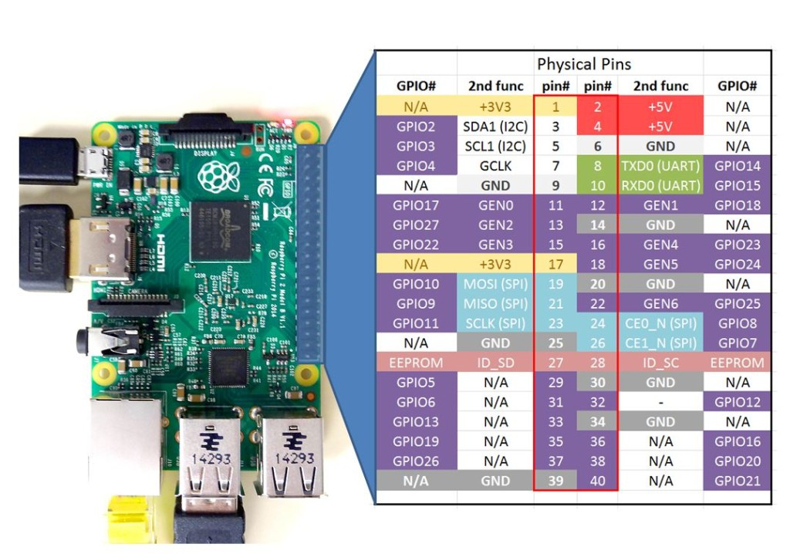

# Installation
```
sudo cp water-meter.service /etc/systemd/system

sudo systemctl enable water-meter.service
```

To test use systemctl start and systemctl stop

# Wiring
The code watches GPIO 2 going to zero - i.e. connecting to ground. So wire up the water meter
between GPIO2 and ground - between pins 3 and 6.



## workshop configuration
Influx is in a container called influxdb at version 1.8

To administer it:
```
docker exec -it influxdb influx
```
It looks for a database called `water` and into that is inserting a measurement point called "water" that has tags location of "Home". Each sample point is 10 litres. Influx data is structured in that there can be zero or more "tag fields" after the datapoint name, and then 1 or more value fields. Hence we send:
```
water,location=Home used=10
```
Where the location fields is a tag, and the used field is the value field for this measurement.

